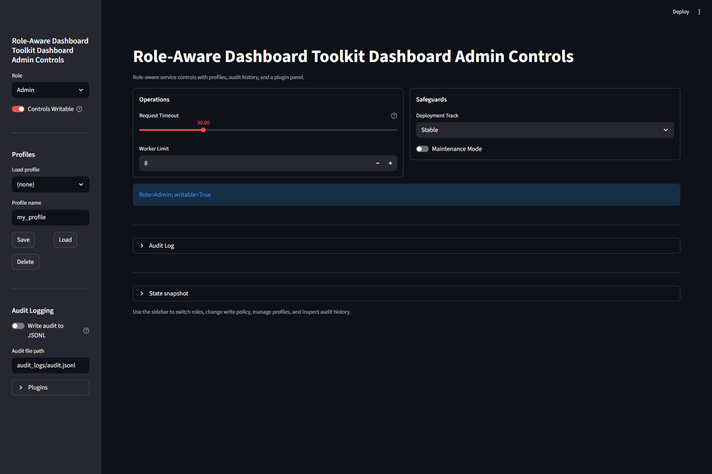

# Role-Aware Dashboard Toolkit

**Python building blocks for operator controls, recorded runs, human review, and investigation workflows.**

Build applications where people can change settings, compare recorded outcomes,
review decisions, and hand off the evidence. The library connects controls and
permissions with saved profiles, audit history, checkpoints, review records,
incident timelines, and cases that span multiple runs.

Use the supplied Streamlit dashboard, integrate the optional FastAPI routes, or
use the dependency-free Python core in your own application. Your application
supplies the data, measurements, model calls, and business actions.

**Early beta · Python 3.10+ · MIT license · Distributed as GitHub source**

[Quick start](#quick-start) · [Examples](examples/README.md) ·
[Documentation](docs/README.md) ·
[Issues](https://github.com/Mike-Byrne-AI/role-aware-dashboard-toolkit/issues)



*The [Dashboard Admin Controls example](examples/dashboard_admin_controls_app.py)
shows the control interface. The review and investigation layers below can also
be used independently of this dashboard.*

## What you can build

- **AI application review tools:** save a baseline configuration, capture a
  candidate with application-supplied measurements, compare checkpoints, and
  record a human decision. Try the [Operator Review Lab](examples/operator_review/README.md).
- **Service and operations consoles:** expose settings such as worker limits,
  timeouts, and maintenance mode with role checks, saved profiles, and a history
  of changes. Connect the controls to your own service logic.
- **Investigation and handoff tools:** collect notes and incidents, assemble a
  timeline, link evidence across runs, and preserve findings and handoff summaries.
- **Review workflows inside existing Python applications:** create, store,
  compare, and export the same records without running a dashboard.

## What is included

| Capability | What it lets your application do |
| --- | --- |
| **Controls and access** | Define validated controls, role permissions, and write freezes. The authenticated adapter connects verified sign-in to server-owned role grants. |
| **Profiles and audit history** | Save named configurations, preview differences, restore settings, and record changes. Values of controls marked sensitive are omitted from saved profiles and redacted in supplied UI/API control-change events. |
| **Runs, checkpoints, and comparisons** | Capture explicit snapshots of settings, audit events, and telemetry; compare recorded settings and measurements; build replay previews and run ledgers. |
| **Human review and decisions** | Attach comments, assignments, signoffs, and handoffs to runs or checkpoints. Derive decision state, blockers, and transition history from those records. |
| **Operator notes, incidents, and cases** | Assemble incident timelines and descriptive handoff summaries. Link evidence from multiple runs into investigation cases with findings, hypotheses, and history. |
| **Governance review** | Preview policy-check results, approval requirements, and blocked or allowed action summaries from supplied evidence; explicitly save review snapshots. Applications enforce the actual actions. |
| **Portable evidence** | Export records in a common JSON envelope, with checks on the envelope and supported payload fields. The Operator Review Lab also produces a standalone, readable HTML report. |
| **Interfaces and extension points** | Compose Streamlit sections, themes, and navigation; add trusted plugins; use optional FastAPI routes; normalize application telemetry and inspect runtime diagnostics. |

The supplied UI and API check permissions before applying a whole profile; a
denied restore leaves controls unchanged. Deferred UI replay checks current
permissions again before applying recorded settings. Optional review panels use
explicitly configured stores, so a small dashboard need not include every layer.

## Quick start

Try a complete review workflow with synthetic data. No model account, identity
provider, or external service is needed for this local example.

Clone or download the [source repository](https://github.com/Mike-Byrne-AI/role-aware-dashboard-toolkit)
and open a terminal in its root directory. With Python 3.10 or later, in
PowerShell on Windows:

```powershell
python -m venv .venv
.\.venv\Scripts\python.exe -m pip install ".[workbench]"
.\.venv\Scripts\python.exe -m streamlit run examples/operator_review/app.py --server.address 127.0.0.1
```

In bash or zsh on macOS or Linux:

```bash
python3 -m venv .venv
.venv/bin/python -m pip install ".[workbench]"
.venv/bin/python -m streamlit run examples/operator_review/app.py --server.address 127.0.0.1
```

If `.venv` already exists, reuse it and skip the first command.

In the browser:

1. Choose Admin or Operator and **Save baseline and start run**.
2. Change the synthetic AI settings, then **Capture candidate for review**.
   Compare the captured settings and outcomes.
3. Choose Approver and record an approval, requested changes, or rejection
   with a reason.
4. Download the JSON evidence or a standalone HTML report for another reader.

The metrics are deterministic teaching formulas, not model performance
measurements. Records last for the browser session unless downloaded. The role
selector demonstrates permissions; it is not authentication. Keep this demo local.
The [Operator Review Lab guide](examples/operator_review/README.md) explains the
workflow, report reader, and persistence boundaries.

## Build your own application

If you followed the quick start, stop the demo with `Ctrl+C` and activate the
same environment from the repository root before changing directories. In
PowerShell:

```powershell
.\.venv\Scripts\Activate.ps1
```

In bash or zsh:

```bash
source .venv/bin/activate
```

The commands below use `python` from that active environment. You can also use
the absolute path to its Python executable if you do not activate environments.

For a new application, use the installed starter. From your own application
directory, with the toolkit's `workbench` extra installed in the active Python
environment. In PowerShell:

```powershell
python -m role_aware_dashboard_toolkit init my-dashboard --dry-run
python -m role_aware_dashboard_toolkit init my-dashboard
Set-Location my-dashboard
python -m streamlit run app.py --server.address 127.0.0.1
```

In bash or zsh:

```bash
python -m role_aware_dashboard_toolkit init my-dashboard --dry-run
python -m role_aware_dashboard_toolkit init my-dashboard
cd my-dashboard
python -m streamlit run app.py --server.address 127.0.0.1
```

The starter creates editable application code, a theme, a README, and an
`AGENTS.md` pointer to the installed handbook. It refuses an existing destination.
For an existing application, adapt the [core quickstart](docs/quickstart.md) or
inspect `python -m role_aware_dashboard_toolkit example starter --format json`.

When working with a coding assistant, have it discover this installed version
before changing your application:

```shell
python -m role_aware_dashboard_toolkit inspect --format json
python -m role_aware_dashboard_toolkit guide start
```

The offline guides cover controls, appearance, permissions, profiles, runs,
telemetry, and API setup. Discovery commands do not create project files; your
instructions and project policy remain authoritative.

## Minimal dashboard

For a minimal application, save this as `app.py` and run
`python -m streamlit run app.py --server.address 127.0.0.1` in the environment
where you installed `workbench`:

```python
import streamlit as st
import role_aware_dashboard_toolkit as radt

if "service_controls_audit" not in st.session_state:
    st.session_state["service_controls_audit"] = radt.AuditLog()

registry = radt.ControlRegistry()
registry.register(
    "Request timeout",
    kind="slider",
    key="request_timeout_seconds",
    min_value=1,
    max_value=120,
    default=30,
)
registry.register(
    "Maintenance mode",
    kind="toggle",
    key="maintenance_mode",
    default=False,
)

config = radt.DashboardConfig(
    title="Service controls",
    registry=registry,
    audit=st.session_state["service_controls_audit"],
    auth_mode="demo",  # local demo: each user picks a role
)

radt.render(config)
```

The audit object survives reruns in this browser session. A new session or
server restart starts a new in-memory history; choose a persistent audit store
when records must survive restarts. A new demo session starts as Viewer, which
can only read; pick a role in the sidebar to change controls.

For durable audit across sessions, share one log per process and start its
writer where you create it, then pass `audit=shared_audit()` and
`audit_dir="audit_logs"` to `DashboardConfig`:

```python
@st.cache_resource
def shared_audit() -> radt.AuditLog:
    audit = radt.AuditLog()
    audit.start_writer("audit_logs/audit.jsonl")
    return audit
```

Every session's and role's events then reach `audit_logs/audit.jsonl`. With one
log per browser session, as in the minimal dashboard, the sidebar's writer
toggle governs only that session's log. See
[persist every session's events](docs/dashboard_tools.md#persist-every-sessions-events).

For controls, profiles, runs, checkpoints, and packet export **without a UI**,
follow the [core quickstart](docs/quickstart.md) or run this example from the
repository root:

```shell
python -m examples.core_library
```

## Installation options

The core has no required third-party dependencies. From a source checkout or
unpacked source release, install only the capabilities you need in your chosen
Python environment:

| Install command | Capability |
| --- | --- |
| `python -m pip install .` | Core controls, records, stores, packets, and offline guides |
| `python -m pip install ".[workbench]"` | Streamlit dashboard and starter |
| `python -m pip install ".[auth]"` | Streamlit sign-in integration and role-grant support |
| `python -m pip install ".[api]"` | FastAPI routes |
| `python -m pip install ".[pandas]"` | Dataframe-backed history views |
| `python -m pip install ".[full]"` | All supported runtime extras |

Distribution name: `role-aware-dashboard-toolkit`. Python import:
`role_aware_dashboard_toolkit`. This release uses GitHub source; package-index
publication is a separate release decision. The supported Streamlit baseline
is 1.65.0. See [distribution details](docs/distribution.md) for package contents.

## Find the right guide

- **Customize the interface:** [dashboard tools](docs/dashboard_tools.md),
  [Studio Dispatch example](examples/studio_dispatch/README.md), and
  [plugin contract](docs/plugins.md).
- **Add verified access:** [authentication](role_aware_dashboard_toolkit/resources/guides/authentication.md),
  [A/B/C Access Lab](examples/section_access/README.md), and
  [single-host deployment](role_aware_dashboard_toolkit/resources/guides/deployment.md).
- **Record and compare work:** [runs](docs/run_model.md),
  [telemetry](docs/telemetry_contract.md), [replay](docs/replay.md), and
  [packets and ledgers](docs/protocol/overview.md).
- **Build review and investigation workflows:** [team operations](docs/team_ops.md),
  [decisions](docs/decision_model.md), [operator memory](docs/operator_memory.md),
  [caseboard](docs/caseboard.md), and [governance](docs/governance.md).
- **Integrate the library:** [public API](docs/public_api.md),
  [API security](docs/api_security.md), [storage](docs/shared_store_patterns.md),
  and [architecture](ARCHITECTURE_SCOPE.md).

The [documentation index](docs/README.md) maps the full guide set; the
[examples index](examples/README.md) describes each runnable application.

## Scope and deployment

- **Identity and authorization:** demo roles are self-selected. For shared use,
  choose `init my-dashboard --auth`, configure an external sign-in provider, and
  provision roles using the authentication guide. The FastAPI adapter has its
  own authentication configuration. Custom callbacks and direct core calls must
  enforce the host application's authorization policy.
- **Review and execution:** decisions, governance summaries, timelines, and
  replay previews describe recorded evidence. They do not execute business
  actions, prove causation, or establish that external mutations occurred.
  The host supplies integrations and enforces its actual action permissions.
  The native governance panel resolves linked evidence from configured stores;
  direct Python callers must load, validate, and supply the evidence records.
  Linked IDs alone do not make the core governance builder fetch their contents.
- **Persistence and collaboration:** in-memory records last only as long as
  their owning session or process. File stores use trusted local storage;
  SQLite access storage coordinates grants and freeze state on one host.
  These do not provide distributed coordination or hosted team collaboration.
- **Extensions and evidence:** plugins run as trusted code. Packet validation
  checks the common envelope and supported payload fields. Applications validate
  their own extension payloads and the truth of supplied evidence; custom packet
  types use the `x_` namespace. Partial payloads can pass packet validation; use
  the record validators when complete records are required. The host owns
  sensitive-data handling, including redaction in custom audit calls.

Evaluate this beta with synthetic data, then complete the deployment acceptance
checks before admitting private data or real users. Tests and examples have
limited scope; they establish neither security certification nor a measured
development-time advantage. See the [security and update policy](SECURITY.md).

## Development

Start with [CONTRIBUTING.md](CONTRIBUTING.md) for environment setup and checks.
Use the [release checklist](docs/release_checklist.md) and
[publication runbook](docs/release_runbook.md) when preparing a release.

Contributions are welcome through the
[issue tracker](https://github.com/Mike-Byrne-AI/role-aware-dashboard-toolkit/issues)
and pull requests. Read the [Code of Conduct](CODE_OF_CONDUCT.md).

Role-Aware Dashboard Toolkit is licensed under the [MIT License](LICENSE).
