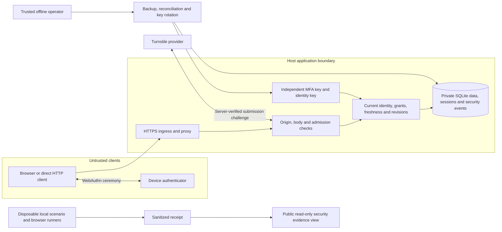

# Westbridge security design and review map

Westbridge is a fictional security testbed on the existing hosted service. Its
purpose is to make security decisions inspectable and exercise their failure
paths. This dossier describes source contracts and named regression tests;
it is not a test receipt, deployment report or security certification.

`[verified/source]` below means the cited implementation contains the described
control. Execution results require a receipt for the exact source and environment.
Regression and CI paths below refer to the full repository checkout; the source
distribution does not ship those test or workflow files.
Read [SECURITY_LAB.md](SECURITY_LAB.md) for exercises and
[HOSTING.md](HOSTING.md) for operator acceptance.

## Assets, adversaries and trust boundaries

Protect authentication secrets, bearer sessions, current permissions, private
staff records, publication decisions, recoverable data and trustworthy evidence.
The modeled adversaries are anonymous internet clients, malicious or revoked
staff accounts, callers holding a stolen session, and operators making mistakes
during restart, recovery or deployment. Database-only disclosure is modeled;
complete compromise of the running host is outside the encryption boundary.

The diagram expresses required boundaries, not proof of current ingress settings.
The operator selects an existing sanitized receipt with
`BUSINESS_SECURITY_EVIDENCE_FILE`; `/security-lab` and `/api/security-lab` only
read it. There is no public scenario runner, file upload or recovery endpoint.
The private event timeline requires current administrator authority.

| Threat | Enforced invariant and source | Decisive regression |
| --- | --- | --- |
| Client invents a role or uses another account's object | Current identity and grants control the operation; display roles and object identifiers confer no authority. [security.py](business/security.py), [app.py](business/app.py) | Adversarial access (`tests/test_business_adversarial_access.py`): every admin route denies untrusted roles; caller-supplied authority fields fail. |
| Revocation races a request or expensive verification | Check current state again at commit. A request admitted before a completed revocation is a distinct concurrency ordering. [auth_routes.py](business/auth_routes.py), [passkeys.py](business/passkeys.py) | Access races (`tests/test_business_adversarial_access.py`), credential races (`tests/test_business_passkeys.py`). |
| Temporary enrollment authority becomes permanent access | One-use, expiring grants start a purpose-bound setup session; only chosen-password and current-TOTP proof can complete enrollment. Current revisions, grant claim and CSRF are rechecked at commit. [enrollment.py](business/enrollment.py), [enrollment_routes.py](business/enrollment_routes.py) | Enrollment policy (`tests/test_business_enrollment_policy.py`): claim/replay, expiry, durable failed budgets, revoked grant, recovery and strict activation. |
| Stolen session performs sensitive administration | Idle activity does not renew the five-minute verification window. Containment remains available; restoring authority requires fresh verification. [session_state.py](business/session_state.py) | Sessions (`tests/test_business_sessions.py`): stale writes denied, pause allowed, resume challenged, draft retained in [browser checks](../../tools/business_dashboard_browser.py). |
| Lost response or stale editor repeats/overwrites work | Host create receipts and revision checks preserve the intended operation. Toolkit shared-state compare-and-set rejects a competing revision. [idempotency.py](business/idempotency.py), [state store](../../role_aware_dashboard_toolkit/state_store.py) | Host retries (`tests/test_business_idempotency.py`), API concurrent state (`tests/test_api_state_store.py`). |
| Old backup resurrects revoked authority | A restore stays quarantined unless reconciled with a trusted current security source; all restored sessions are revoked. [backup.py](backup.py) | Backup recovery (`tests/test_business_backup.py`), [scenario runner](../../tools/business_security_demo.py). |
| Security recording or delivery fails | Required mutation events and delivery obligations share the transaction. Delivery retries use stable IDs; the business action is not replayed. [security_events.py](business/security_events.py) | Event failures and crash windows (`tests/test_business_security_events.py`). |
| Rotation fails halfway or a worker retains its old key | Enrollment ciphertext and key binding change together; original key files remain; each runtime transaction checks its cached key against current binding. [rotation CLI](rotate_mfa_key.py), [db.py](business/db.py) | Rotation (`tests/test_business_mfa_rotation.py`): row/binding faults, real process exit, stale workers and old-backup recovery. |

## Decisions and their limits

- **Server authority is current and transactional.** `[verified/source]`
  Westbridge evaluates session, permission, freeze and revision in its SQLite
  transaction. The generic toolkit API can use separate access, state, profile
  and audit adapters. It does not make those stores one atomic transaction.
  In particular, an API state operation can commit before an audit adapter fails;
  the response reports that outcome and must not cause blind retry. See
  [API security](../../docs/api_security.md) and
  committed-operation audit failures (`tests/test_api_audit_failures.py`).
- **Authentication methods have different assurance.** `[verified/source]`
  Under strict policy both roles use password plus TOTP or a user-verified
  passkey. Completed accounts require MFA even while other accounts remain in
  transition. Only legacy employees in explicit transition retain password-only
  sign-in; legacy administrators retain their existing factor requirement.
  TOTP accepts only the current 30-second step and consumes it once. Recovery
  is a trusted offline operator action after external identity proofing.
  Passkey challenges are one-use and origin/RP-bound, but no device attestation
  proves hardware provenance. A stolen bearer cookie still has authority until
  expiry/revocation; adding passkeys does not remove weaker fallback paths.
- **Enrollment is a separate authority.** `[verified/source]` Fresh provisioning
  starts strict with pending accounts. A 24-hour grant cannot authenticate an
  ordinary session. Successful claim consumes it and creates at most one
  ten-minute setup session per account, with a separate opaque bearer and CSRF
  proof. Pending seeds are encrypted with account/generation context. Completion
  requires a compliant chosen password and current code from the new TOTP seed;
  it installs confirmed MFA, revokes existing sessions/challenges and records its
  required event atomically. No automatic login follows, and the setup code's
  consumed time step cannot be reused for sign-in. Lost start responses require
  offline reissue; a lost completion response is an uncertain credential change.
- **Migration must reach an explicit final policy.** `[verified/source]`
  Schema-eight migration preserves existing access as legacy in transition.
  Account-specific migration grants preserve that access until completion;
  completing enrollment is the only promotion to active. Strict activation
  refuses any active account without completed enrollment and a confirmed TOTP
  factor or passkey, requires an enrolled administrator, and revokes sessions.
  Stored readiness does not prove actual-device possession. Transition is a
  rollout state, not a stronger-authentication acceptance result.
- **Recovery grants are takeover authority.** `[verified/source]` Offline
  recovery immediately makes the account pending, invalidates its credentials,
  passkeys and sessions, and records a required opaque operator case reference
  in a durable issuance decision. The reference points to an external identity
  check; it does not perform or prove that check. A stolen grant can enroll an
  attacker's password and authenticator. Completion rejects the retired password;
  its retained hash is never accepted for authentication. Recovery cannot enable
  a disabled account. Reissue invalidates older setup authority, and all-admin
  reset removes every active administrator's current access. Prefer recovery
  scoped to one account. See [operator commands](README.md#enrollment-migration-and-recovery).
- **Containment remains available.** `[verified/source]` Pausing edits,
  unpublishing and disabling an account are narrow operations, not permission to
  edit arbitrary records during a freeze. Session inactivity expires after
  30 minutes and absolute lifetime at the fixed eight-hour browser-flow deadline;
  later sign-ins can receive less than eight hours. Reads do not renew fresh
  verification. At most eight sessions are kept per account, with oldest excess
  sessions removed on sign-in. These are testbed policy choices.
- **Reverification replaces the bearer.** `[verified/source]` Password/TOTP and
  passkey reverification atomically replace the session token and CSRF proof,
  preserving the public session identifier, original absolute expiry and
  credential revocation bindings. Old tokens have no grace period, even after
  response loss. Retained predecessor hashes cannot authenticate or select a
  replacement session. Full sign-in uses a separate signed HttpOnly flow and
  a generation-bound context: one successful commit wins each generation,
  and a deliberate later generation replaces its current public session ID.
  A late cookie response may require another sign-in; it cannot reopen that
  invalidated session. Every bound session ends by the flow's fixed horizon,
  including a login completed just before expiry. Closed flows are retained
  until expiry, with bounded admission and a durable clock floor preventing
  reinterpretation after clock rollback. Independent cold starts remain outside
  correlation; a stolen flow plus valid credentials can evict its current head.
- **Availability has an explicit budget.** `[verified/source]` Account attempt
  budgets persist; expensive work has bounded per-process admission. A targeted
  attacker can exhaust a known account's budget, and shared proxy peers can share
  public-submission limits. These controls do not promise sustained-load
  availability or configured edge protection. See [abuse exercises](SECURITY_LAB.md#abuse-decisions-and-availability).
- **Logging has separate guarantees.** `[verified/source]` Activity history,
  aggregate counters and durable security events are different records. Required
  events fail the associated mutation if they cannot commit. Denial observations
  have a bounded budget; suppressed observations and recording failures remain
  visible in counters. Schema nine freezes event bytes and records obligations
  for every active destination atomically. The default local idempotent consumer
  remains distinct from an explicitly enabled HTTPS collector. Every destination
  must acknowledge before source pruning; a local receipt cannot clear remote
  retention. The [collector reference](../security_event_collector/README.md)
  adds immutable accepted records, dedicated replay-resistant heartbeats,
  durable alert transitions and a separately credentialed operator inbox.
  Running these on one computer does not prove off-host custody or human response.
  A lifespan-owned worker attempts at most 100 local deliveries per cycle, with
  five-second waits between cycles; protected status reports progress and failures. Pending
  obligations are retained; capacity exhaustion can still refuse sensitive work.
  Ordinary admission keeps retained events plus usable employee sessions within
  9,000 slots. Each such session reserves its eventual termination receipt; only
  a verified removal of an owned session may consume that reservation. The final
  1,000 slots remain administrator authentication/containment headroom, and
  administrator actions preserve employee reservations. Existing overfull state
  reports a reservation deficit and needs draining before these guarantees apply.
  This is finite headroom, not unlimited availability; an offline operator can
  repair delivery for an exhausted queue if automatic delivery cannot recover it.
  Remote configuration failure cannot disable an obligation or discard pending
  history. The collector also has finite event and operational budgets; complete
  collector failure requires independent monitoring.
- **Key custody and recovery are operational work.** `[verified/source]`
  MFA encryption protects database-only disclosure. A host able to read both key
  and database can decrypt seeds. Rotation does not erase already exposed seeds,
  old pages or backups. Identity-key migration is separate and unsupported by
  the MFA rotation command. Old-before-rotation backup tests use the same current
  schema. An explicit `restore --upgrade-backup-schema` can also upgrade a
  validated schema-five through schema-nine archive only in private
  restore staging; current schema-ten authority is required to leave quarantine.
  Reconciliation preserves current policy, lifecycle, factor state and durable
  operator decision references. It discards enrollment grants and pending setup
  sessions; pending accounts need offline reissue and remain unable to sign in.
  The original archive stays unchanged.
  See `tests/test_business_backup_schema_upgrade.py`.

## Selected OWASP ASVS 5.0.0 review map

These versioned IDs reference the pinned official release, not changing branch
content. The map selects review targets; it does not establish an ASVS level or
complete coverage. Requirement descriptions below are abbreviated. Primary
references: [Authentication](https://github.com/OWASP/ASVS/blob/v5.0.0/5.0/en/0x15-V6-Authentication.md),
[Sessions](https://github.com/OWASP/ASVS/blob/v5.0.0/5.0/en/0x16-V7-Session-Management.md),
[Authorization](https://github.com/OWASP/ASVS/blob/v5.0.0/5.0/en/0x17-V8-Authorization.md),
[Logging and errors](https://github.com/OWASP/ASVS/blob/v5.0.0/5.0/en/0x25-V16-Security-Logging-and-Error-Handling.md).

| Requirement | Source and targeted test evidence | Review scope or gap |
| --- | --- | --- |
| `v5.0.0-6.2.3` Current password for password changes | [auth_routes.py](business/auth_routes.py); password policy (`tests/test_business_password_policy.py`), `test_current_password_is_checked_before_choice_screening` | Current-password proof is separate from password-quality screening. |
| `v5.0.0-6.3.1` Controls against password attacks | [auth_routes.py](business/auth_routes.py), [work_limits.py](business/work_limits.py); authentication limits (`tests/test_business_auth_limits.py`) | Local durable budgets and admission; edge configuration and calibrated hosted load require their own evidence. |
| `v5.0.0-6.5.1` Single use of TOTP | [mfa.py](business/mfa.py); admin MFA (`tests/test_business_admin_mfa.py`), `test_simultaneous_admin_logins_consume_code_once` | Transactionally consumed server-side counter; separate from physical-device proof. |
| `v5.0.0-7.4.1`, `v5.0.0-7.4.2` Session termination and disabled accounts | [security.py](business/security.py), [session_routes.py](business/session_routes.py); sessions (`tests/test_business_sessions.py`), adversarial access (`tests/test_business_adversarial_access.py`) | Rejection at the next protected request is the acceptance observation. |
| `v5.0.0-7.2.4` New token on authentication and reverification | [session_state.py](business/session_state.py), [passkeys.py](business/passkeys.py); sessions (`tests/test_business_sessions.py`), passkeys (`tests/test_business_passkeys.py`) | Both reverification paths rotate bearer and CSRF; copied predecessors are rejected. Lost replies require sign-in again if the replacement was not received. |
| `v5.0.0-7.5.2`, `v5.0.0-7.5.3` Session management and sensitive-operation verification | [session_state.py](business/session_state.py), [session_routes.py](business/session_routes.py); sessions (`tests/test_business_sessions.py`) | Own-session inventory and revocation, five-minute freshness; containment exceptions are deliberate. |
| `v5.0.0-8.2.1`, `v5.0.0-8.3.1` Trusted enforcement of function access | [app.py](business/app.py), [security.py](business/security.py); admin route matrix (`tests/test_business_adversarial_access.py`) | Every sensitive route needs inventory coverage; hidden UI controls are not the boundary. |
| `v5.0.0-16.2.5` Protect sensitive data in logs | [security_events.py](business/security_events.py); event field rejection (`tests/test_business_security_events.py`), `test_fixed_fields_refuse_secret_content_and_unverified_identity` | Fixed codes and opaque principals; actual host/proxy logging must be inspected separately. |
| `v5.0.0-16.3.1`, `v5.0.0-16.3.2` Authentication/authorization event coverage | [security_events.py](business/security_events.py); denial budgets (`tests/test_business_security_events.py`) | **Partial:** bounded denial suppression means this is not a complete record of every attempt/decision. |
| `v5.0.0-16.5.3` Secure failure behavior | [db.py](business/db.py), [security_events.py](business/security_events.py); event rollback (`tests/test_business_security_events.py`), rotation interruption (`tests/test_business_mfa_rotation.py`) | Targeted host transaction coverage, not a guarantee for every adapter or exception. |

Additional review targets are `v5.0.0-6.3.3` for the role-wide MFA policy and
`v5.0.0-6.4.1` for temporary enrollment authority. The controls described here
do not establish compliance with either requirement: transition still permits
legacy employee password-only access, and delivery and identity proofing require
operator evidence. The fictional provisioned `admin` account still needs review
under `v5.0.0-6.3.2` before production adaptation. The local collector reference
does not establish independently operated logging custody under `v5.0.0-16.4.3`;
actual deployment control and recovery require separate verification.
These are explicit review boundaries, not exemptions or
claims of an ASVS level.

## From source to a demonstrable result

1. **Identify tested bytes.** [evidence.py](business/evidence.py) fingerprints a
   defined code/assets/configuration/test set and records Git identity/dirty state,
   runtime versions, UTC times and local scope. A source-changing run fails.
   The [scenario runner](../../tools/business_security_demo.py) uses disposable
   data for revocation, competing toolkit edits and reconciled recovery. The
   [browser runner](../../tools/business_dashboard_browser.py) emits a sanitized
   receipt alongside private diagnostics. Test definitions alone are not results.
2. **Display the boundary.** [security_lab.py](business/security_lab.py) serves
   operator-supplied observations. Missing, failed, stale and unavailable evidence
   remain distinguishable. Receipt checksums detect changes, not dishonest authors.
   A source snapshot is cached per serving process: restart after code changes.
   Receipt tests (`tests/test_security_evidence.py`) and
   public-view tests (`tests/test_business_security_lab.py`) enforce the safe
   projection. Raw credentials, paths, screenshots and exceptions stay private.
3. **Bind builds and dependencies.** Contributor CI (`.github/workflows/contributor-ci.yml`)
   uses SHA-pinned actions and multiple Python/OS lanes.
   Dependency audits (`.github/workflows/dependency-audit.yml`) retain exact
   resolved inventories and scanner outcomes for seven days.
   Release CI (`.github/workflows/ci.yml`) binds artifact hashes to source and
   workflow identity. None proves that a specific hosted process runs those bytes.
4. **Accept the existing hosted testbed.** Follow [HOSTING.md](HOSTING.md) to match
   the deployed revision/configuration, verify actual HTTPS/proxy behavior,
   exercise a real-device passkey session and reconcile a recovery cutover.
   Preserve successes, failures and not-run work with their environment. Local
   virtual authenticators, synthetic identity adapters and receipt imports cannot
   substitute for these observations.

A standard SBOM and signed build attestation could extend this chain later.
They are not generated by this dossier or implied by dependency-audit inventories
and checksums. A curated showcase evidence pack should retain the reviewed
receipts beyond transient CI retention without publishing private diagnostics.
